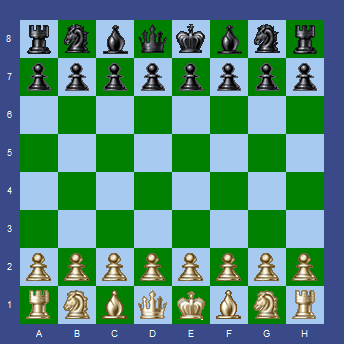

# ChessBoard for Delphi

A reusable Delphi/VCL chessboard component with legal-move handling, FEN positions, move history, and a UCI-engine demonstration application.

## Highlights

- Native `TChessBoard` VCL component
- Legal moves, castling, promotion, en passant, check and mate handling
- FEN import/export and reversible move history
- Configurable colors, orientation, labels, bitmaps and move highlighting
- Events for moves, promotion, castling, stalemate and draw conditions
- UCI sample GUI with engine communication and PV highlighting
- Pawnora UCI engine included for immediate testing
- Delphi 7-friendly structure and modern RAD Studio support

## Repository map

- `ChessBoard_final/component/` — component, chess types, rules, package and bitmap assets
- `ChessBoard_final/ChessInterfaceUCI3/` — VCL/UCI demonstration program
- `ChessBoard_final/engines/` — bundled Pawnora test engine

## Build

Run `build.bat release` (default) or `build.bat debug`. The script locates RAD Studio, supplies the component unit path, and builds the Win32 demo. Component developers can also open `component/ChessBoardPackage.dpk` directly.

The demo reads `Chess.ini`; replace the `Engine` path with any compatible UCI engine if desired.

## Download

The [latest release](https://github.com/delphi-coder/chessboard/releases/latest) contains the GUI, configuration file and Pawnora engine in a portable folder.

## License

MIT — see [LICENSE](LICENSE).

